# Amiscara Deck

[](#requirements)
[](apps/AmiscaraDeck)
[](crates)
[](https://github.com/toolwerk/amiscara-deck/releases/latest)
[](#license)

[Deutsch](README.md) · **English**

A menu bar tool for the Mac. It shows all AI coding agents on your machine and takes their approvals and questions, no matter which terminal they run in.

> Amiscara Deck is an unofficial project. It is not affiliated with Anthropic or OpenAI. Claude Code and Codex are products of their respective vendors.

<p align="center">
  <picture>
    <source media="(prefers-color-scheme: light)" srcset="docs/images/en/panel-hell.png">
    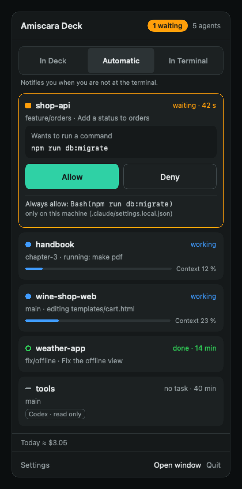
  </picture>
</p>

The app speaks English or German, following the language of macOS. You can set a language for Deck alone in System Settings under General, Language & Region, Applications. All pictures show made up example data.

## Contents

- [What it is for](#what-it-is-for)
- [Install and set up](#install-and-set-up)
- [The symbol and the panel](#the-symbol-and-the-panel)
- [Where you answer: the switch](#where-you-answer-the-switch)
- [Answering approvals](#answering-approvals)
- [Answering questions](#answering-questions)
- [Getting your attention](#getting-your-attention)
- [The window](#the-window)
- [Codex](#codex)
- [Other machines](#other-machines)
- [Linux](#linux)
- [Windows](#windows)
- [Interface for Linux and Windows](#interface-for-linux-and-windows)
- [Command line](#command-line)
- [Updates](#updates)
- [Security and privacy](#security-and-privacy)
- [Troubleshooting](#troubleshooting)
- [Removing it](#removing-it)
- [Development](#development)

## What it is for

With several agents at once it happens quickly: one has been waiting for a yes for ten minutes, and nobody saw it. It runs in another window, another terminal or on another machine. That is what Amiscara Deck is for.

- **Overview.** Who is working, who is waiting, who is done. With project, branch, current activity, context fill and estimated cost.
- **Answer without searching.** You answer approvals and questions in the panel, in the window or in the notification.
- **Notify only when needed.** In automatic mode Deck stays quiet while you sit at the terminal.

Deck does not start agents and does not replace a terminal. With Claude Code the dialog in the terminal is always there. Whoever answers first counts. Codex works differently, see [Codex](#codex).

## Install and set up

### Requirements

- macOS 27 on Apple silicon
- Claude Code 2.1.331 or later (older versions are untested)
- Codex is optional, see [Codex](#codex)

### Install

Download the zip of the [latest version](https://github.com/toolwerk/amiscara-deck/releases/latest) and unpack it. The app is signed and notarized by Apple. If you would rather [build it yourself](#development), see below.

### Set up

1. Move the app to `/Applications` before you install anything. The entries in Claude Code name the path of a program inside the app.
2. Start the app. It has no Dock icon, only a symbol in the menu bar.
3. In the panel choose "Settings" and click "Install" under "Claude Code".
4. Allow notifications when macOS asks.
5. If you like, switch on "Start at login".

Running sessions appear with their next event, new ones at once.

<p align="center">
  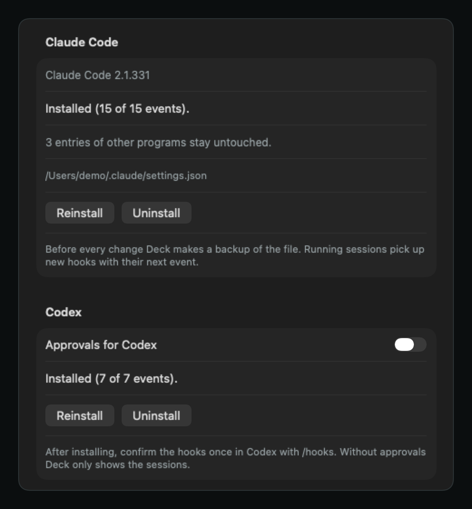
</p>

Installing only adds Deck's own entries to `~/.claude/settings.json`. Entries of other programs stay as they are. Before every change a backup is written next to the file (`settings.json.deck-….bak`), the last five are kept. "Uninstall" takes the entries out again.

For another configuration folder (for example when using `CLAUDE_CONFIG_DIR`), choose **Add profile …** under Claude Code and install that profile’s hooks. Questions and approvals from all connected profiles arrive in the same Deck instance.

## The symbol and the panel

The symbol in the menu bar shows whether somebody is waiting for you. You can switch off the number next to it.

<p align="center">
  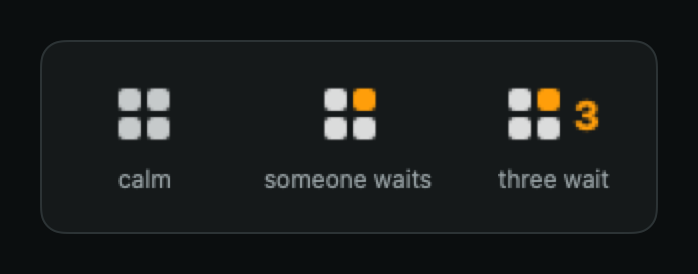
</p>

- **Left click** opens the panel.
- **Right click** opens a menu: open the window, settings, check for updates, quit.

The panel lists the agents waiting for you at the top. Besides its color every state has a shape of its own:

| Mark | State |
|---|---|
| filled orange square | waits for you |
| dashed orange square | waits in the terminal, Deck does not hold the request |
| blue dot | working |
| green ring | done |
| diamond | error |
| dash | no task |
| faint ring | ended |

## Where you answer: the switch

| Position | Behavior |
|---|---|
| **In Deck** | Deck notifies you about every approval. |
| **Automatic** | Deck notifies only when you are not at the terminal. Default. |
| **In Terminal** | Deck holds nothing and notifies nothing. You answer in the terminal only. |

In automatic mode Deck notifies when the screen is locked, you have been idle for more than 2 minutes, another program than the agent's terminal is in front, or tmux does not show its pane.

The **wait time** (30 seconds to 9 minutes, 2 minutes by default) sets how long Deck holds a request. After that it stays in the terminal.

<p align="center">
  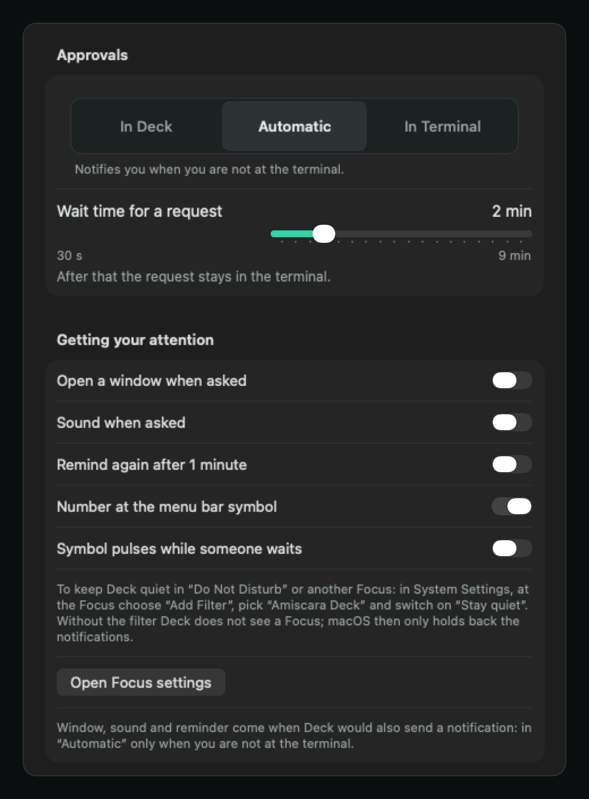
</p>

## Answering approvals

<p align="center">
  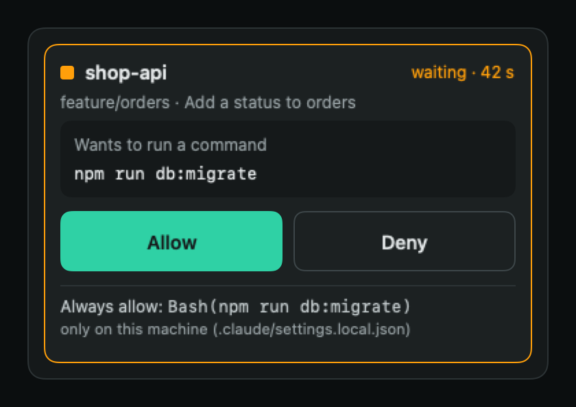
</p>

- **Allow** and **Deny** take effect at once. The dialog in the terminal disappears by itself.
- **Always allow** sits small below. You read there which rule will be created and where it applies, before you click. A broad rule (for everybody in the repository, or for all projects) is highlighted.

### Shortened requests

If a request is too long for the card, you first get only **View** and **Deny**. You can allow it only after the full text has been shown.

<p align="center">
  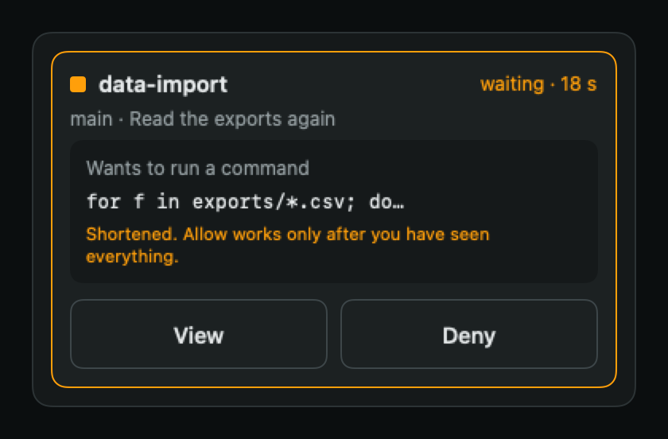
  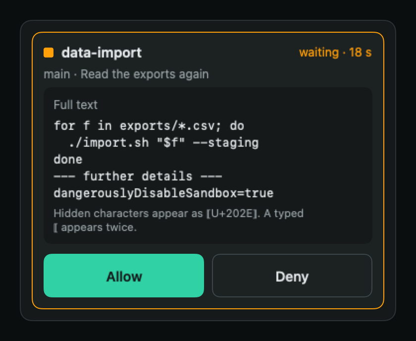
</p>

"further details" lists everything else the call asks for, for example running a command without its sandbox. Invisible characters are made visible.

### When the time is up

<p align="center">
  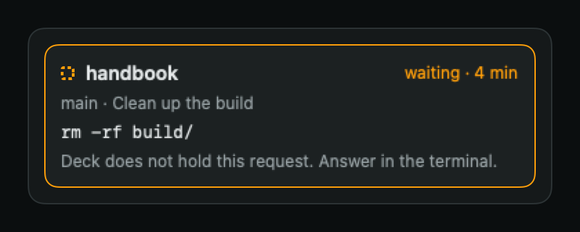
</p>

Deck then only shows that the agent is waiting. You answer in the terminal.

## Answering questions

When an agent asks a question with choices, you answer it right on the card.

<p align="center">
  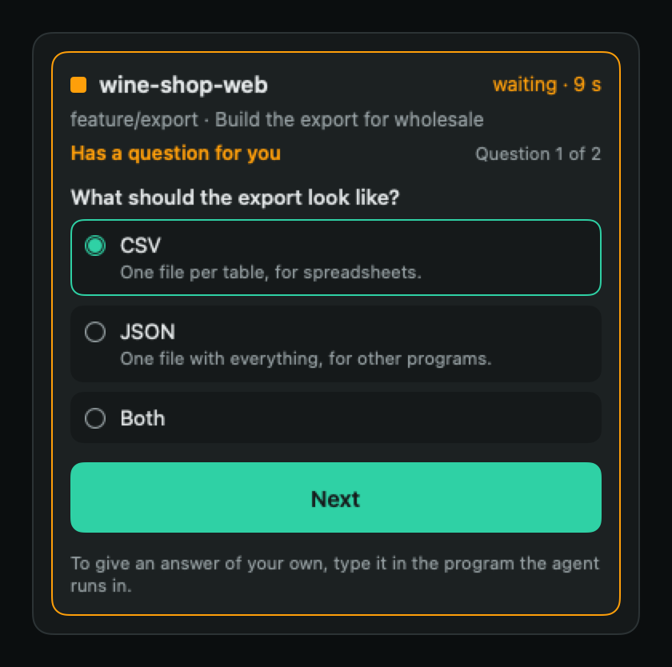
</p>

- Several questions come one after the other, with "Next" and "Back".
- "Answer" sends everything to the agent.
- A free text answer of your own is typed in the program the agent runs in.

Deck does not answer plans waiting for approval. Those stay in the agent's program.

## Getting your attention

The base is the macOS **notification**. An approval offers "Allow" and "Deny" there. A shortened one offers "View" and "Deny", a question only "View". If notifications are switched off, Deck says so and leads you to the right system setting.

If that is not enough, switch on more in the settings:

- a floating window that does not take the keyboard
- a sound
- a reminder after 1 minute
- the number of waiting agents next to the symbol (on by default)
- a blinking symbol

<p align="center">
  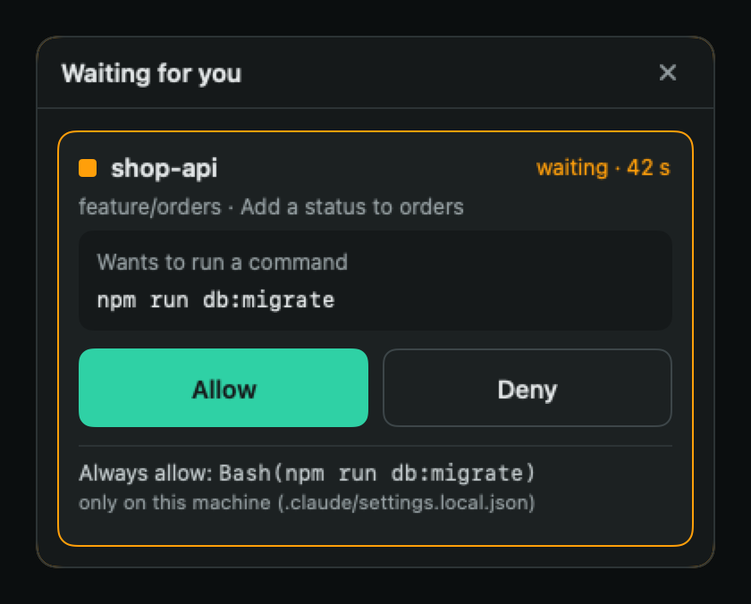
</p>

Window, sound and reminder appear only when Deck would also send a notification.

### Staying quiet in a Focus

On its own Deck cannot detect a Focus. To keep Deck silent during "Do Not Disturb", for example:

1. Open the Focus in System Settings.
2. Choose "Add Filter", then "Amiscara Deck".
3. Switch on "Stay quiet".

The cards in the panel stay visible.

## The window

"Open window" shows all agents side by side, with a filter by state. The column on the right shows the selected agent: open request, last task, key figures and history.

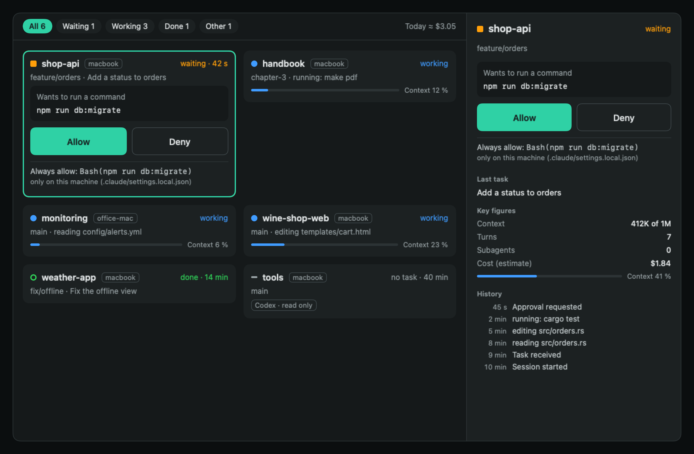

### Text size

In the settings under "Appearance" you choose the text size: Small, Normal, Large or Extra large. It applies to the panel, the window, the floating window and the settings. The panel and the window get wider with it. In the window ⌘+, ⌘- and ⌘0 work as well. Notifications, the icon menu and the icon itself stay as they are.

### Context and cost

- Deck reads the **context fill** from the transcript of the session.
- The **cost** is the estimate of Claude Code, per session and as a total for today. It is not a bill.

If Deck does not know a model yet, it assumes 200,000 tokens. Put the right size into `~/Library/Application Support/Amiscara Deck/context-windows.json`. The key is a part of the model name:

```json
{ "my-model": 500000 }
```

## Codex

Deck shows Codex sessions. Tested with Codex CLI 0.171.0: project, branch, prompt, activity and status are right, also after ending and resuming a session. Codex reports a session only with the first prompt, Deck does not show it before that.

1. In the settings click "Install" under "Codex". The section appears when Codex is installed.
2. In Codex run `/hooks` once and confirm the entries.

**Approvals for Codex** are off and can be switched on. There is one difference: Codex shows its dialog only after Deck gives the request back. So Deck holds it only when it would also send a notification, and gives it back as soon as you are at the terminal again. Codex has no "always allow".

## Other machines

Deck also shows the agents of other machines and answers their requests. The connection runs over SSH. No network port is opened.

On the other machine Deck's daemon runs and the hooks are installed there:

- **Mac:** install the app and set it up as above. Switch on "Remote Login" in System Settings, General, Sharing. The app must run there, best with "Start at login".
- **Linux:** set it up as under [Linux](#linux). Not tested as the other machine yet.

Then add the machine on your Mac in the settings under "Other machines":

| Field | Meaning |
|---|---|
| Name | shown on the cards |
| Host, user, port | as with `ssh` |
| Key file | empty: Deck uses the SSH agent |
| Socket there | empty: the usual place |

If your Mac does not know the key of the machine yet, Deck shows its fingerprint and waits for your yes. If the key changes later, Deck does not connect.

Deck does not start the daemon on the other machine itself. If it is not running there, Deck says so in the settings and names the next step. As soon as the daemon runs, Deck connects by itself. Deck names a refused sign-in, an unusable key and a machine that does not answer the same way.

## Linux

The daemon, the hook program and the command line run on Linux. There is a first interface as well, see [Interface for Linux and Windows](#interface-for-linux-and-windows). Your Mac can also show the agents of the Linux machine and answer their requests (see [Other machines](#other-machines)).

Unpack the package for x86_64 or aarch64 and set it up:

```sh
tar xzf amiscara-deck-<version>-linux-x86_64.tar.gz
cd amiscara-deck-<version>-linux-x86_64
./install.sh
```

`install.sh` puts the three programs into `~/.local/bin`, installs the hooks in `~/.claude/settings.json` and sets up the daemon as a systemd user unit. It starts at once and at every login. The programs are built statically and run on any distribution with systemd.

Without a connected interface Deck holds no request, and Claude Code shows its dialog as usual. `amiscara-deck watch` in a second terminal shows what the agents are doing.

The daemon logs to the journal (`journalctl --user -u amiscara-deckd`). `./install.sh --uninstall` removes hooks and daemon again.

To build the package yourself, on macOS or Linux with Docker or Podman:

```sh
scripts/package-linux.sh
```

The archives are then in `dist/`.

## Windows

On Windows Deck is at its very beginning. The daemon, the hook program and the command line run, plus a first [interface](#interface-for-linux-and-windows). Daemon and hook program talk over a named pipe that only your user can open.

Unpack the package and set it up in PowerShell:

```powershell
powershell -ExecutionPolicy Bypass -File install.ps1
```

`install.ps1` puts the programs into `%LOCALAPPDATA%\Programs\Amiscara Deck`, installs the hooks in `%USERPROFILE%\.claude\settings.json` and registers the daemon to start at login (Run key of your user, no administrator rights). It starts at once and without a window, its messages are in `deckd.log` in the data folder `%LOCALAPPDATA%\Amiscara Deck`. `install.ps1 -Uninstall` removes hooks and start at login and ends the daemon.

Do not start the daemon as administrator: then the hook program cannot reach it, and Claude Code shows its normal dialog. Claude Code in WSL does not reach the daemon on Windows yet.

To build the package yourself, on macOS or Linux with Docker or Podman:

```sh
scripts/package-windows.sh
```

## Interface for Linux and Windows

The first version shows an icon in the tray and a panel. The icon turns orange as soon as an approval waits. The panel lists the agents, waiting approvals are on top with **Allow** and **Deny**. Long requests show **View** first, as on the Mac. Questions and plans are still answered where the agent runs. Main window, notifications and presence follow.

The interface needs the running daemon (see [Linux](#linux) and [Windows](#windows)). The panel opens at start, closing only hides it. A click on the icon (on Linux "Open panel" in the icon menu) opens it again.

Without presence, "Automatic" holds every approval in Deck while the interface runs. If you rather answer in the terminal, quit the interface from the icon menu.

To build it yourself (Node.js and Rust, on Linux also WebKitGTK):

```sh
cd apps/deck-desktop
npm ci
npx tauri build
```

## Command line

The app ships the program `amiscara-deck`:

```sh
/Applications/AmiscaraDeck.app/Contents/Helpers/amiscara-deck list
```

| Command | Purpose |
|---|---|
| `list` | print all agents once, `--json` for scripts |
| `watch` | print changes as they happen |
| `answer <request> allow\|deny` | answer a request |
| `hooks status\|install\|uninstall` | manage the entries in Claude Code |
| `daemon status\|install\|uninstall` | start the daemon at login, without the app (macOS: LaunchAgent, Linux: systemd, Windows: Run key) |
| `sim demo` | play made up agents, to try things out without spending tokens |

`amiscara-deck help` shows the options. Its output is English or German, following the environment: the first value set of `DECK_LANGUAGE`, `LC_ALL`, `LC_MESSAGES` and `LANG` counts.

## Updates

A released version checks for a new one at start and once a day. It downloads it in the background and installs it when it quits. A menu bar app is rarely quit, so the panel announces a waiting version with "Restart now".

<p align="center">
  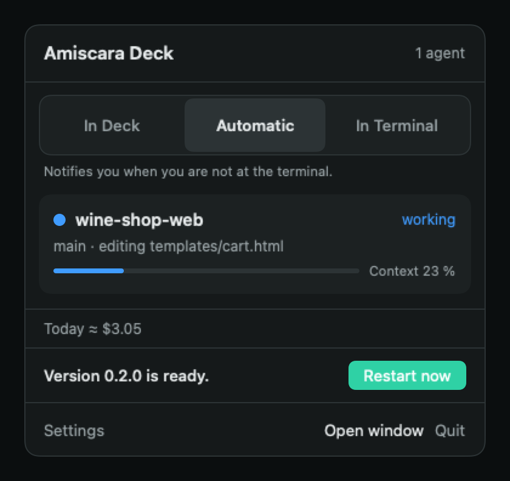
</p>

Updates are signed. In the settings you can switch off the automatic check or check by hand. Debug builds of your own do not update.

## Security and privacy

- Every error in the hook program ends silently with exit code 0. The normal dialog then appears. Deck must never be the reason an agent hangs.
- Without a connected interface Deck holds no request.
- A shortened request can be allowed only after the full text has been shown. The app and the daemon both check this.
- The daemon opens no network port. It talks over a Unix socket that only your user can read.
- History and the log of decisions stay on your machine. You choose 1, 7 or 30 days, or delete them at once. There is no telemetry.
- The app goes online only to look for updates (can be switched off) and to reach machines you add yourself.

All data is kept in `~/Library/Application Support/Amiscara Deck`.

## Troubleshooting

| Problem | What helps |
|---|---|
| An agent does not appear | Are the hooks installed? A running session appears only with its next event. |
| No notification | Allow notifications in System Settings. Check the switch: in "Automatic" Deck stays quiet while you are at the terminal. Check the Focus filter. |
| Nothing happens after moving the app | Click "Reinstall" in the settings, so the new path is written. |
| The background daemon hangs | End it with `pkill -x amiscara-deckd`. The app starts it again. |
| The context fill is wrong | Enter the size of the model in `context-windows.json`. |

## Removing it

Remove the entries first and delete the app afterwards. That way Claude Code keeps no entry without a program.

1. In the settings click "Uninstall" for Claude Code and for Codex.
2. Switch off "Start at login".
3. Quit the app.
4. End the daemon: `pkill -x amiscara-deckd`
5. Delete the app and the folder `~/Library/Application Support/Amiscara Deck`.

The backups next to `settings.json` stay until you delete them.

## Development

### Build it yourself

You need Xcode, Rust (stable) and [xcodegen](https://github.com/yonaskolb/XcodeGen).

Set up once:

```sh
./setup.sh
```

Then build the app:

```sh
xcodebuild -project apps/AmiscaraDeck/AmiscaraDeck.xcodeproj -scheme AmiscaraDeck -configuration Release -derivedDataPath target/xcode-release build
```

Put your own developer certificate into `DEVELOPMENT_TEAM` in `apps/AmiscaraDeck/project.yml`. Without a certificate, `CODE_SIGNING_ALLOWED=NO` builds the app.

### Layout

| Part | Purpose |
|---|---|
| `amiscara-deckd` | background daemon, holds the state and the open requests |
| `deck-hook` | small program that Claude Code and Codex call |
| `amiscara-deck` | command line |
| Mac app | SwiftUI, talks to the Rust core through UniFFI |

The logic is written in Rust under `crates/`. Findings from checks against the real programs are in `docs/`, the hand test list in [docs/handtest.md](docs/handtest.md), the release steps in [docs/release.md](docs/release.md). These documents are in German.

### Redraw the pictures

The app draws the pictures of this page itself, with made up data. The English ones land in `docs/images/en`:

```sh
TEST_RUNNER_DECK_SCREENSHOT_DIR="$PWD/docs/images" xcodebuild -project apps/AmiscaraDeck/AmiscaraDeck.xcodeproj -scheme AmiscaraDeck -derivedDataPath target/xcode CODE_SIGNING_ALLOWED=NO test -only-testing:AmiscaraDeckTests/ScreenshotTests
```

### Translating texts

Texts in the code are English and marked: `L10n.t("…")` in Swift, `t("…")` in Rust, placeholders as `{name}`. The template `po/deck.pot` comes from the code, German is in `po/de.po`. After changing a text:

```sh
python3 scripts/i18n.py extract
python3 scripts/i18n.py check
```

`check` fails when the template is out of date or a text in `de.po` is missing, empty, fuzzy or has other placeholders. The build turns the files into `Localizable.strings` for the Mac app.

### Contributing

One issue per task, branch `feature/<n>-slug` or `fix/<n>-slug`, squash merge, an entry in `CHANGELOG.md` (German) and in `CHANGELOG.en.md` (English). Before you push:

```sh
cargo fmt --all --check && cargo clippy --workspace --all-targets --locked -- -D warnings && cargo test --workspace --locked
python3 scripts/release-notes.py check
```

Related to [Amiscara Agents](https://github.com/staude/amiscara-agents), but independent of it.

## License

[MIT](LICENSE-MIT) or [Apache 2.0](LICENSE-APACHE), at your option.
