# Amiscara Deck

[](#voraussetzungen)
[](apps/AmiscaraDeck)
[](crates)
[](https://github.com/toolwerk/amiscara-deck/releases/latest)
[](#lizenz)

**Deutsch** · [English](README.en.md)

Ein Menüleisten-Werkzeug für den Mac. Es zeigt alle KI-Coding-Agenten auf Ihrem Rechner und nimmt ihre Freigaben und Fragen an, egal in welchem Terminal sie laufen.

> Amiscara Deck ist ein inoffizielles Projekt. Es steht in keiner Verbindung zu Anthropic oder OpenAI. Claude Code und Codex sind Produkte der jeweiligen Anbieter.

<p align="center">
  <picture>
    <source media="(prefers-color-scheme: light)" srcset="docs/images/panel-hell.png">
    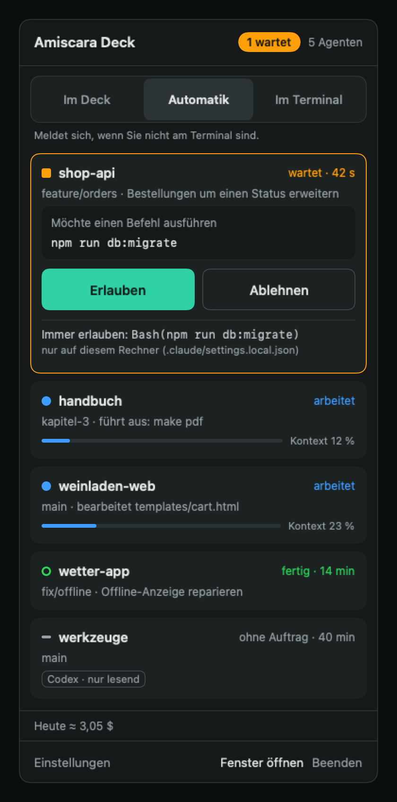
  </picture>
</p>

Die App spricht Deutsch oder Englisch, je nach Sprache von macOS. Eine eigene Sprache nur für Deck stellen Sie in den Systemeinstellungen unter Allgemein, Sprache & Region, Apps ein. Alle Bilder zeigen erfundene Beispieldaten.

## Inhalt

- [Wofür es gedacht ist](#wofür-es-gedacht-ist)
- [Installieren und einrichten](#installieren-und-einrichten)
- [Das Symbol und das Panel](#das-symbol-und-das-panel)
- [Wo Sie antworten: der Schalter](#wo-sie-antworten-der-schalter)
- [Freigaben beantworten](#freigaben-beantworten)
- [Fragen beantworten](#fragen-beantworten)
- [Aufmerksam machen](#aufmerksam-machen)
- [Das Fenster](#das-fenster)
- [Codex](#codex)
- [Andere Rechner](#andere-rechner)
- [Befehlszeile](#befehlszeile)
- [Updates](#updates)
- [Sicherheit und Datenschutz](#sicherheit-und-datenschutz)
- [Wenn etwas nicht geht](#wenn-etwas-nicht-geht)
- [Entfernen](#entfernen)
- [Entwickeln](#entwickeln)

## Wofür es gedacht ist

Bei mehreren Agenten gleichzeitig passiert es schnell: Einer wartet seit zehn Minuten auf ein Ja, und niemand hat es gesehen. Er läuft in einem anderen Fenster, in einem anderen Terminal oder auf einem anderen Rechner. Dafür gibt es Amiscara Deck.

- **Überblick.** Wer arbeitet, wer wartet, wer ist fertig. Mit Projekt, Zweig, aktueller Tätigkeit, Kontextfüllung und geschätzten Kosten.
- **Antworten ohne Suchen.** Freigaben und Fragen beantworten Sie im Panel, im Fenster oder in der Mitteilung.
- **Melden nur, wenn nötig.** In der Automatik schweigt Deck, solange Sie am Terminal sitzen.

Deck startet keine Agenten und ersetzt kein Terminal. Bei Claude Code bleibt der Dialog im Terminal immer da. Wer zuerst antwortet, zählt. Bei Codex ist das anders, siehe [Codex](#codex).

## Installieren und einrichten

### Voraussetzungen

- macOS 27 auf Apple Silicon
- Claude Code ab 2.1.331 (ältere Versionen sind ungeprüft)
- Codex ist optional, siehe [Codex](#codex)

### Installieren

Laden Sie das Zip der [neuesten Version](https://github.com/toolwerk/amiscara-deck/releases/latest) und entpacken Sie es. Die App ist signiert und von Apple notarisiert. Wer lieber [selbst baut](#entwickeln), findet unten den Weg.

### Einrichten

1. Die App nach `/Applications` legen, bevor Sie etwas einbauen. Die Einträge in Claude Code nennen den Pfad eines Programms innerhalb der App.
2. Die App starten. Sie hat kein Symbol im Dock, nur eines in der Menüleiste.
3. Im Panel auf "Einstellungen" und unter "Claude Code" auf "Einbauen".
4. Mitteilungen erlauben, wenn macOS fragt.
5. Auf Wunsch "Beim Anmelden starten" einschalten.

Laufende Sitzungen erscheinen beim nächsten Ereignis, neue sofort.

<p align="center">
  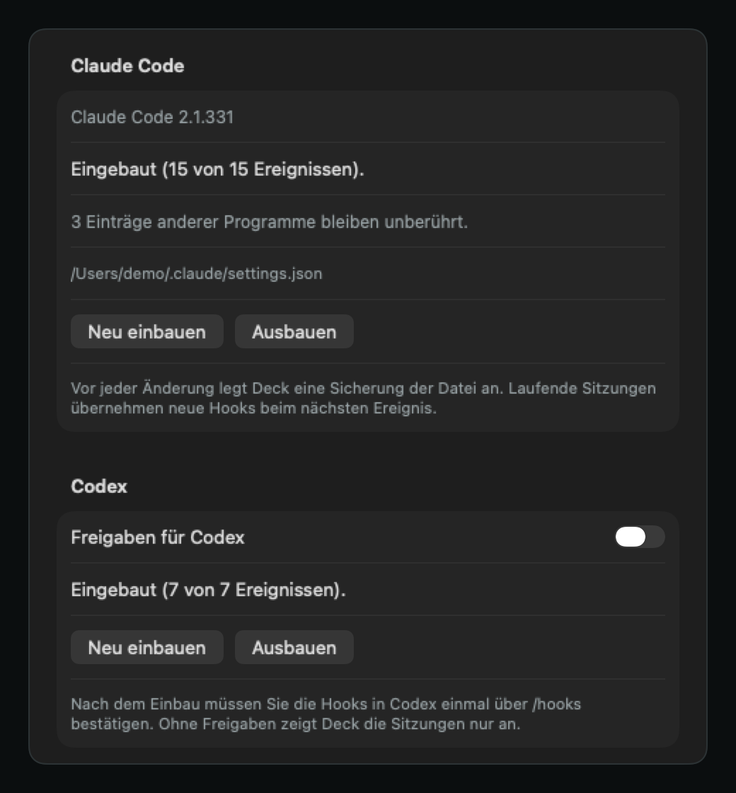
</p>

Beim Einbauen ergänzt Deck nur seine eigenen Einträge in `~/.claude/settings.json`. Einträge anderer Programme bleiben, wie sie sind. Vor jeder Änderung entsteht daneben eine Sicherung (`settings.json.deck-….bak`), die letzten fünf bleiben erhalten. "Ausbauen" entfernt die Einträge wieder.

## Das Symbol und das Panel

Das Symbol in der Menüleiste zeigt, ob jemand auf Sie wartet. Die Zahl daneben lässt sich abschalten.

<p align="center">
  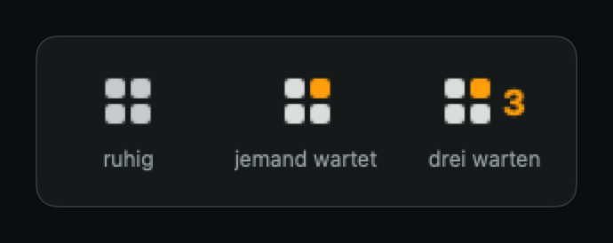
</p>

- **Linksklick** öffnet das Panel.
- **Rechtsklick** öffnet ein Menü: Fenster öffnen, Einstellungen, nach Updates suchen, beenden.

Im Panel steht oben, wer auf Sie wartet. Jeder Zustand hat neben der Farbe eine eigene Form:

| Zeichen | Zustand |
|---|---|
| gefülltes oranges Quadrat | wartet auf Sie |
| gestricheltes oranges Quadrat | wartet im Terminal, Deck hält die Anfrage nicht |
| blauer Punkt | arbeitet |
| grüner Ring | fertig |
| Raute | Fehler |
| Strich | ohne Auftrag |
| blasser Ring | beendet |

## Wo Sie antworten: der Schalter

| Stellung | Verhalten |
|---|---|
| **Im Deck** | Deck meldet sich bei jeder Freigabe. |
| **Automatik** | Deck meldet sich nur, wenn Sie nicht am Terminal sind. Voreinstellung. |
| **Im Terminal** | Deck hält nichts und meldet nichts. Antworten gibt es nur im Terminal. |

In der Automatik gilt: Deck meldet sich, wenn der Bildschirm gesperrt ist, Sie länger als 2 Minuten nichts getan haben, ein anderes Programm vorn ist als das Terminal des Agenten oder tmux dessen Ausschnitt gerade nicht zeigt.

Die **Wartezeit** (30 Sekunden bis 9 Minuten, voreingestellt 2 Minuten) bestimmt, wie lange Deck eine Anfrage hält. Danach bleibt sie im Terminal.

<p align="center">
  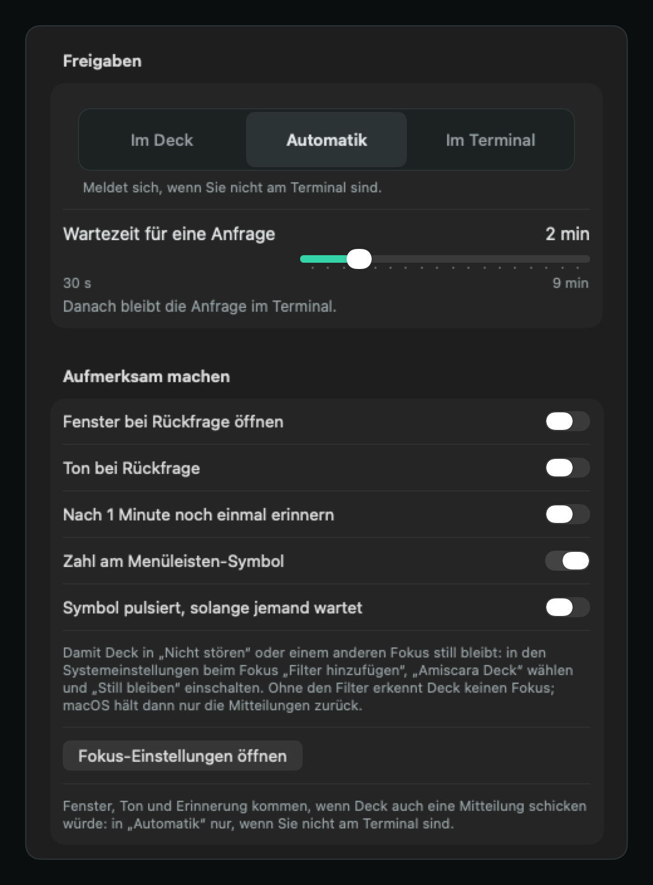
</p>

## Freigaben beantworten

<p align="center">
  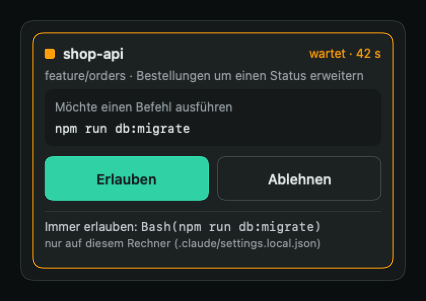
</p>

- **Erlauben** und **Ablehnen** wirken sofort. Der Dialog im Terminal verschwindet von selbst.
- **Immer erlauben** steht klein darunter. Dort lesen Sie vorher, welche Regel entsteht und wo sie gilt. Eine weite Regel (für alle im Repo oder für alle Projekte) ist farbig hervorgehoben.

### Gekürzte Anfragen

Ist eine Anfrage zu lang für die Karte, gibt es zuerst nur **Ansehen** und **Ablehnen**. Erlauben können Sie erst, nachdem der ganze Text gezeigt wurde.

<p align="center">
  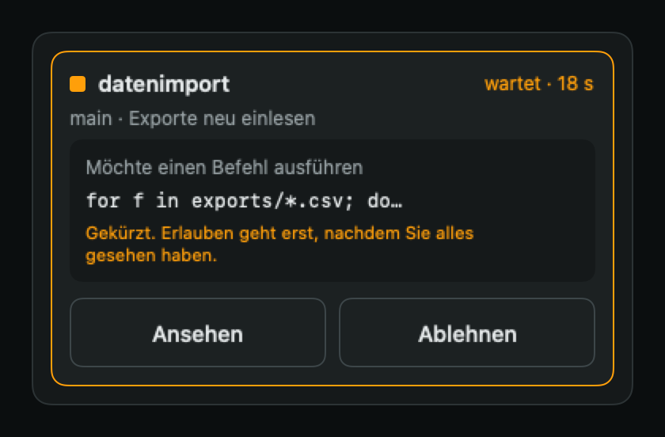
  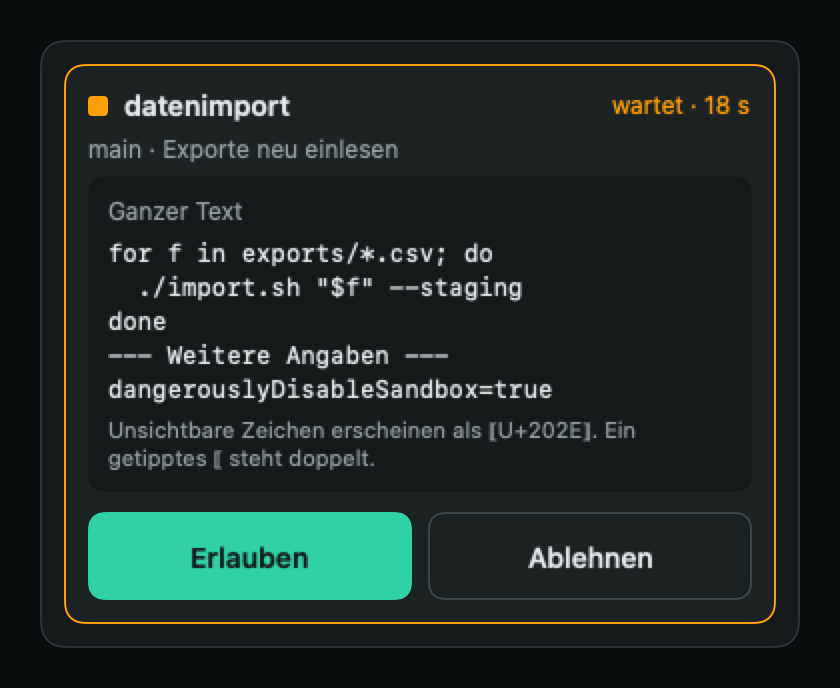
</p>

Unter "Weitere Angaben" steht alles, was der Aufruf sonst noch verlangt, zum Beispiel ein Befehl ohne Sandbox. Unsichtbare Zeichen werden sichtbar gemacht.

### Wenn die Zeit abgelaufen ist

<p align="center">
  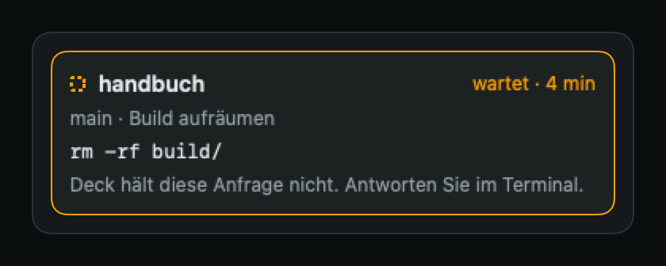
</p>

Dann zeigt Deck nur noch, dass der Agent wartet. Sie antworten im Terminal.

## Fragen beantworten

Stellt ein Agent eine Frage mit Auswahl, beantworten Sie sie direkt auf der Karte.

<p align="center">
  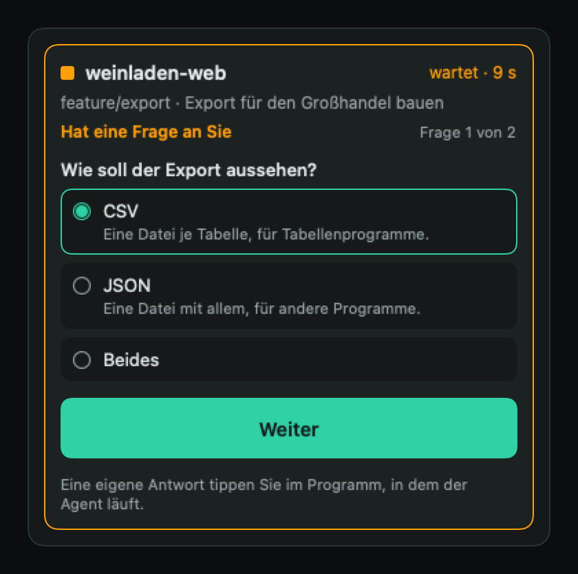
</p>

- Mehrere Fragen kommen nacheinander, mit "Weiter" und "Zurück".
- "Antworten" schickt alles an den Agenten.
- Eine eigene Antwort in Worten tippen Sie im Programm, in dem der Agent läuft.

Pläne zur Freigabe beantwortet Deck nicht. Die bleiben im Programm des Agenten.

## Aufmerksam machen

Grundlage ist die **Mitteilung** von macOS. Eine Freigabe hat dort die Knöpfe "Erlauben" und "Ablehnen". Eine gekürzte hat "Ansehen" und "Ablehnen", eine Frage nur "Ansehen". Sind Mitteilungen ausgeschaltet, sagt Deck das und führt zur richtigen Systemeinstellung.

Wenn das nicht reicht, schalten Sie in den Einstellungen mehr dazu:

- ein schwebendes Fenster, das die Tastatur nicht wegnimmt
- einen Ton
- eine Erinnerung nach 1 Minute
- die Zahl der Wartenden am Symbol (voreingestellt an)
- ein pulsierendes Symbol

<p align="center">
  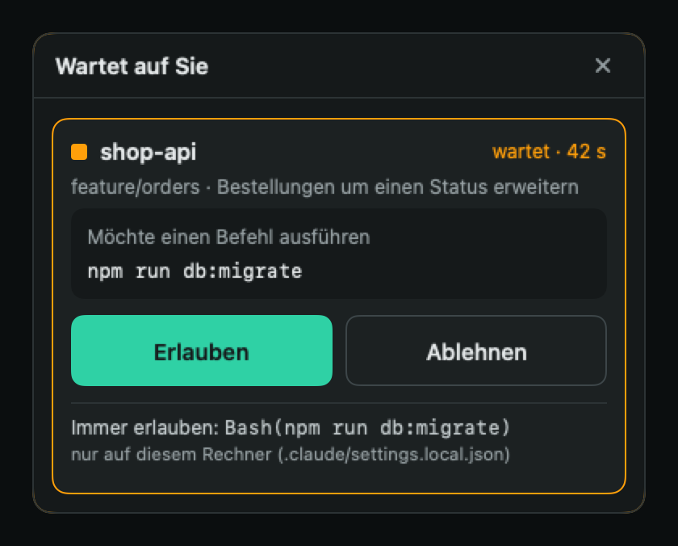
</p>

Fenster, Ton und Erinnerung kommen nur dann, wenn Deck auch eine Mitteilung schicken würde.

### Still bleiben in einem Fokus

Von sich aus erkennt Deck keinen Fokus. Soll Deck zum Beispiel bei "Nicht stören" schweigen:

1. In den Systemeinstellungen den Fokus öffnen.
2. "Filter hinzufügen" wählen, dann "Amiscara Deck".
3. "Still bleiben" einschalten.

Die Karten im Panel bleiben sichtbar.

## Das Fenster

"Fenster öffnen" zeigt alle Agenten nebeneinander, mit Filter nach Zustand. Rechts stehen die Einzelheiten des gewählten Agenten: offene Anfrage, letzter Auftrag, Kennzahlen und Verlauf.

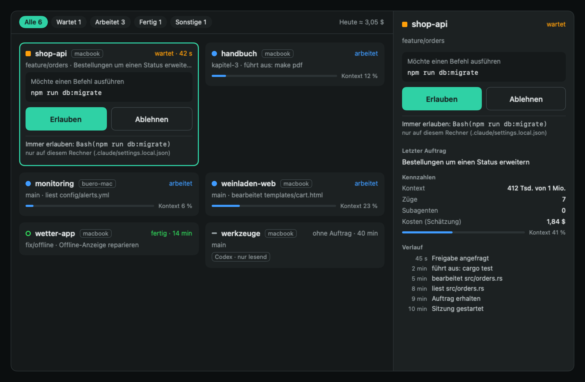

### Kontext und Kosten

- Die **Kontextfüllung** liest Deck aus dem Protokoll der Sitzung.
- Die **Kosten** sind die Schätzung von Claude Code, je Sitzung und als Summe für heute. Sie sind keine Abrechnung.

Kennt Deck ein Modell noch nicht, rechnet es mit 200.000 Tokens. Die richtige Größe tragen Sie in `~/Library/Application Support/Amiscara Deck/context-windows.json` ein. Der Schlüssel ist ein Teil des Modellnamens:

```json
{ "mein-modell": 500000 }
```

## Codex

Deck zeigt Codex-Sitzungen an. Das ist weniger erprobt als Claude Code.

1. In den Einstellungen unter "Codex" auf "Einbauen". Der Abschnitt erscheint, wenn Codex installiert ist.
2. In Codex einmal `/hooks` aufrufen und die Einträge bestätigen.

**Freigaben für Codex** sind ausgeschaltet und lassen sich zuschalten. Dabei gibt es einen Unterschied: Codex zeigt seinen Dialog erst, wenn Deck die Anfrage freigibt. Deck hält sie deshalb nur, wenn es auch eine Mitteilung zeigen würde, und gibt sie frei, sobald Sie wieder am Terminal sind. "Immer erlauben" gibt es bei Codex nicht.

## Andere Rechner

Deck zeigt auch die Agenten anderer Rechner und beantwortet deren Anfragen. Die Verbindung läuft über SSH. Es wird kein Netzwerk-Port geöffnet.

Auf dem anderen Rechner läuft der Dienst von Deck, und die Hooks sind dort eingebaut:

- **Mac:** die App installieren und wie oben einrichten.
- **Linux:** noch wenig erprobt. Die drei Programme bauen, die Hooks einbauen und den Dienst selbst starten:

```sh
cargo build --release -p deck-daemon -p deck-hook -p deck-cli
```

Die Hooks einbauen:

```sh
target/release/amiscara-deck hooks install
```

Den Dienst starten:

```sh
target/release/amiscara-deckd
```

Dann auf Ihrem Mac in den Einstellungen unter "Andere Rechner" den Rechner hinzufügen:

| Feld | Bedeutung |
|---|---|
| Name | steht auf den Karten |
| Host, Benutzer, Port | wie bei `ssh` |
| Schlüsseldatei | leer: Deck nutzt den SSH-Agenten |
| Socket dort | leer: der übliche Ort |

Kennt Ihr Mac den Schlüssel des Rechners noch nicht, zeigt Deck den Fingerabdruck und wartet auf Ihr Ja. Ändert sich der Schlüssel später, verbindet Deck nicht.

## Befehlszeile

Die App bringt das Programm `amiscara-deck` mit:

```sh
/Applications/AmiscaraDeck.app/Contents/Helpers/amiscara-deck list
```

| Befehl | Aufgabe |
|---|---|
| `list` | alle Agenten einmal ausgeben, `--json` für Skripte |
| `watch` | Änderungen laufend ausgeben |
| `answer <Anfrage> allow\|deny` | eine Anfrage beantworten |
| `hooks status\|install\|uninstall` | Einträge in Claude Code verwalten |
| `daemon status\|install\|uninstall` | den Dienst beim Anmelden starten, ohne die App |
| `sim demo` | erfundene Agenten abspielen, zum Ausprobieren ohne Tokens |

`amiscara-deck help` zeigt alle Optionen. Die Ausgabe ist deutsch oder englisch, je nach Umgebung: Es zählt der erste gesetzte Wert aus `DECK_LANGUAGE`, `LC_ALL`, `LC_MESSAGES` und `LANG`.

## Updates

Eine fertige Version prüft beim Start und einmal am Tag, ob es eine neue gibt. Sie lädt sie im Hintergrund und setzt sie beim Beenden ein. Weil eine Menüleisten-App selten beendet wird, meldet das Panel eine wartende Version mit "Jetzt neu starten".

<p align="center">
  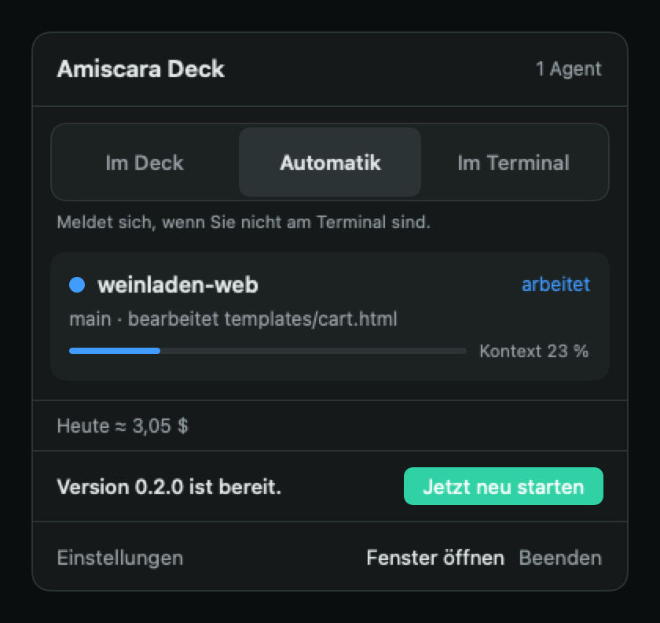
</p>

Updates sind signiert. In den Einstellungen schalten Sie die automatische Suche ab oder suchen von Hand. Selbst gebaute Debug-Versionen aktualisieren sich nicht.

## Sicherheit und Datenschutz

- Jeder Fehler im Hook-Programm endet still mit Code 0. Dann erscheint der normale Dialog. Deck darf nie der Grund sein, dass ein Agent hängt.
- Ohne verbundene Oberfläche hält Deck keine Anfrage.
- Eine gekürzte Anfrage lässt sich erst erlauben, nachdem der ganze Text gezeigt wurde. Die App und der Dienst prüfen das beide.
- Der Dienst öffnet keinen Netzwerk-Port. Er spricht über einen Unix-Socket, den nur Ihr Benutzer lesen kann.
- Verlauf und Entscheidungslog bleiben auf Ihrem Rechner. Sie wählen 1, 7 oder 30 Tage oder löschen sie sofort. Es gibt keine Telemetrie.
- Ins Netz geht die App nur, um nach Updates zu suchen (abschaltbar) und um Rechner zu erreichen, die Sie selbst eintragen.

Alle Daten liegen in `~/Library/Application Support/Amiscara Deck`.

## Wenn etwas nicht geht

| Problem | Das hilft |
|---|---|
| Ein Agent erscheint nicht | Sind die Hooks eingebaut? Eine laufende Sitzung erscheint erst beim nächsten Ereignis. |
| Keine Mitteilung | Mitteilungen in den Systemeinstellungen erlauben. Schalter prüfen: In "Automatik" schweigt Deck, solange Sie am Terminal sitzen. Fokus-Filter prüfen. |
| Nach dem Verschieben der App passiert nichts | In den Einstellungen "Neu einbauen", damit der neue Pfad eingetragen wird. |
| Der Hintergrunddienst hängt | Mit `pkill -x amiscara-deckd` beenden. Die App startet ihn neu. |
| Die Kontextfüllung stimmt nicht | Größe des Modells in `context-windows.json` eintragen. |

## Entfernen

Bauen Sie zuerst die Einträge aus und löschen Sie danach die App. So bleibt in Claude Code kein Eintrag ohne Programm zurück.

1. In den Einstellungen bei Claude Code und bei Codex "Ausbauen".
2. "Beim Anmelden starten" ausschalten.
3. Die App beenden.
4. Den Dienst beenden: `pkill -x amiscara-deckd`
5. Die App und den Ordner `~/Library/Application Support/Amiscara Deck` löschen.

Die Sicherungen neben `settings.json` bleiben liegen, bis Sie sie löschen.

## Entwickeln

### Selbst bauen

Sie brauchen Xcode, Rust (stable) und [xcodegen](https://github.com/yonaskolb/XcodeGen).

Einmal einrichten:

```sh
./setup.sh
```

Dann die App bauen:

```sh
xcodebuild -project apps/AmiscaraDeck/AmiscaraDeck.xcodeproj -scheme AmiscaraDeck -configuration Release -derivedDataPath target/xcode-release build
```

Ein eigenes Entwicklerzertifikat tragen Sie in `apps/AmiscaraDeck/project.yml` unter `DEVELOPMENT_TEAM` ein. Ohne Zertifikat baut `CODE_SIGNING_ALLOWED=NO` die App.

### Aufbau

| Teil | Aufgabe |
|---|---|
| `amiscara-deckd` | Hintergrunddienst, hält den Zustand und die offenen Anfragen |
| `deck-hook` | kleines Programm, das Claude Code und Codex aufrufen |
| `amiscara-deck` | Befehlszeile |
| Mac-App | SwiftUI, spricht über UniFFI mit dem Rust-Kern |

Die Logik liegt in Rust unter `crates/`. Befunde aus den Prüfungen am echten Programm stehen in `docs/`, die Handtest-Liste in [docs/handtest.md](docs/handtest.md), der Ablauf für Versionen in [docs/release.md](docs/release.md).

### Bilder neu erzeugen

Die Bilder dieser Seite zeichnet die App selbst, mit erfundenen Daten. Die englischen landen in `docs/images/en`:

```sh
TEST_RUNNER_DECK_SCREENSHOT_DIR="$PWD/docs/images" xcodebuild -project apps/AmiscaraDeck/AmiscaraDeck.xcodeproj -scheme AmiscaraDeck -derivedDataPath target/xcode CODE_SIGNING_ALLOWED=NO test -only-testing:AmiscaraDeckTests/ScreenshotTests
```

### Texte übersetzen

Texte im Code sind englisch und markiert: `L10n.t("…")` in Swift, `t("…")` in Rust, Platzhalter als `{name}`. Die Vorlage `po/deck.pot` entsteht aus dem Code, Deutsch steht in `po/de.po`. Nach einer Änderung an einem Text:

```sh
python3 scripts/i18n.py extract
python3 scripts/i18n.py check
```

`check` schlägt fehl, wenn die Vorlage nicht zum Code passt oder ein Text in `de.po` fehlt, leer, unsicher (`fuzzy`) ist oder andere Platzhalter hat. Der Bau macht daraus `Localizable.strings` für die Mac-App.

### Mitarbeiten

Ein Issue je Aufgabe, Branch `feature/<n>-slug` oder `fix/<n>-slug`, Squash-Merge, Eintrag im `CHANGELOG.md`. Vor dem Push:

```sh
cargo fmt --all --check && cargo clippy --workspace --all-targets --locked -- -D warnings && cargo test --workspace --locked
```

Verwandt mit [Amiscara Agents](https://github.com/staude/amiscara-agents), aber unabhängig davon.

## Lizenz

[MIT](LICENSE-MIT) oder [Apache 2.0](LICENSE-APACHE), nach Ihrer Wahl.
